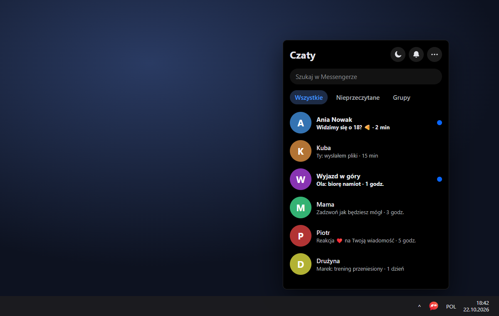

<h1 align="center">Messy</h1>

Messenger in your Windows tray. / Messenger w zasobniku Windows. 
<a href="https://github.com/Parallax373/messy/releases/latest"><b>Download / Pobierz</b></a>

## English

Meta shut down the Messenger desktop app and messenger.com. Messy brings Messenger back to the desktop:
it lives in the system tray, and a click on its icon opens a compact chat panel right above the taskbar,
the way Steam or Discord do. Click anywhere else and it hides.

- **Tray icon pinned to the taskbar**, turning red only when you have unread **messages**
  (likes, comments and other Facebook notifications don't count)
- **Just the chat:** Facebook's top bar is gone and the chat fills the whole panel
- **OLED mode:** true black instead of Facebook's grey dark theme
- **Mute notifications** with one click, right in the Chats header
- **Resizable panel** that remembers its size
- **Four modes**, one click away in the header: panel above the tray, free (stays on top wherever you drag it), normal window, or docked to a screen edge as a thin tab with the unread count that slides out on hover
- **Starts with Windows** (can be turned off in the tray menu)
- **Updates itself** in the background
- **Polish and English**, following your Windows language

**Install:** download `Messy-Setup-<version>.exe` from
[Releases](https://github.com/Parallax373/messy/releases/latest) and run it. No admin rights needed.
Windows may show a SmartScreen warning because the installer isn't signed yet:
click **More info → Run anyway**.

**Privacy:** Messy only shows facebook.com/messages. Your login and messages go straight to Facebook,
and Messy has no servers, analytics or telemetry. Details in [PRIVACY.md](PRIVACY.md).

## Polski

Meta zamknęła aplikację Messenger na komputer i stronę messenger.com. Messy przywraca Messengera na pulpit:
siedzi w zasobniku, a kliknięcie ikony otwiera kompaktowy panel czatu tuż nad paskiem zadań, jak w Steamie
czy Discordzie. Kliknięcie gdzie indziej go chowa.

- **Ikona przypięta na pasku zadań**, czerwona tylko przy nieprzeczytanych **wiadomościach**
  (polubienia, komentarze i inne powiadomienia Facebooka się nie liczą)
- **Sam czat:** bez górnego paska Facebooka, czat wypełnia cały panel
- **Tryb OLED:** czysta czerń zamiast szarego ciemnego motywu Facebooka
- **Wyciszanie powiadomień** jednym kliknięciem, w nagłówku „Czaty”
- **Zmiana rozmiaru panelu**, zapamiętywana
- **Cztery tryby** do wyboru jednym kliknięciem w nagłówku: panel nad zasobnikiem, swobodny (zostaje na wierzchu tam, gdzie go przeciągniesz), zwykłe okno albo przy krawędzi ekranu jako wąska zakładka z licznikiem nieprzeczytanych, wysuwana po najechaniu
- **Uruchamianie z Windowsem** (można wyłączyć w menu ikony)
- **Sam się aktualizuje** w tle
- **Polski i angielski**, zależnie od języka Windowsa

**Instalacja:** pobierz `Messy-Setup-<wersja>.exe` z
[wydań](https://github.com/Parallax373/messy/releases/latest) i uruchom. Nie potrzeba uprawnień
administratora. Windows może pokazać ostrzeżenie SmartScreen, bo instalator nie jest jeszcze podpisany:
kliknij **Więcej informacji → Uruchom mimo to**.

**Prywatność:** Messy tylko wyświetla facebook.com/messages. Logowanie i wiadomości idą prosto do Facebooka,
a Messy nie ma serwerów, analityki ani telemetrii. Szczegóły w [PRIVACY.md](PRIVACY.md).

---

Messy is an unofficial app and is not affiliated with, endorsed by or connected to Meta Platforms, Inc.,
Facebook or Messenger. / Messy to nieoficjalna aplikacja, niepowiązana z Meta Platforms, Inc., Facebookiem
ani Messengerem.

[MIT License](LICENSE) · [Development](CONTRIBUTING.md)
